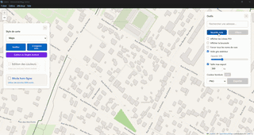

# Carto - Éditeur de Cartes Interactif

Application de bureau multiplateforme pour l'édition de cartes interactives avec des données OpenStreetMap et l'export SVG haute qualité.

### Aperçu de l'application



## Fonctionnalités

- **Multi-zones (jusqu'à 5)** : Dessinez plusieurs zones, les chevauchements sont fusionnés automatiquement
- **Sélection de zone polygonale** : Dessinez des zones, ajustez les points, arrondissez les angles
- **Aperçu fidèle** : La carte affiche les éléments exactement comme l'export (mêmes éléments, même ordre, mêmes couleurs, largeurs et pointillés)
- **Export multi-format** : SVG (vectoriel), PNG et JPEG (image), PDF (document)
- **Thèmes** : Maps (palette mesurée sur Google Maps), OpenStreetMap, ou vos propres presets
- **Style détaillé** : Pour chaque niveau de route, couleur, bordure, largeur et trait (plein, pointillés, tirets…) ; voies ferrées par type (train, métro léger, tramway, métro) ; routes en tunnel et cours d'eau souterrains
- **Édition individuelle des couleurs** : Recolorez des bâtiments, routes, espaces naturels ou cours d'eau, au clic ou par polygone
- **Système de règles personnalisées** : Éditeur avancé de règles basé sur les tags OSM avec conditions imbriquées
- **Rulesets prédéfinis** : Maps et OpenStreetMap, avec import/export (.mrules)
- **Valeurs dépendantes du zoom** : Couleurs et largeurs adaptées au niveau de zoom
- **Personnalisation des polices** : Choix de la police et option gras pour les labels
- **Recherche d'adresses** : Localisez et centrez la carte sur une adresse (Nominatim)
- **Mode hors-ligne** : Chargez des fichiers .osm locaux pour travailler sans connexion
- **Panneaux réductibles** : Minimisez les panneaux pour plus d'espace carte
- **Mises à jour automatiques** : Vérification et téléchargement des mises à jour depuis GitHub
- **Données OSM complètes** : Routes, bâtiments, parcs, forêts, plans d'eau, cours d'eau, voies ferrées, POIs… y compris les grandes surfaces en multipolygone (lacs avec îles, fleuves, forêts avec clairières)
- **Noms de rues intelligents** : Abréviations automatiques (Rue → r., Avenue → av., etc.)
- **Multiplateforme** : Windows, macOS et Linux

---

## Installation

### Télécharger les binaires (recommandé)

Téléchargez la dernière version depuis la page [Releases](../../releases) :

| Plateforme | Fichier | Instructions |
|------------|---------|--------------|
| **Windows** | `Carto-X.X.X.exe` | Double-cliquez pour lancer (portable, pas d'installation) |
| **Windows** | `Carto-X.X.X-win.zip` | Décompressez et lancez `Carto.exe` |
| **macOS** | `Carto-X.X.X-mac.zip` | Décompressez, glissez `Carto.app` dans Applications |
| **Linux** | `Carto-X.X.X.AppImage` | `chmod +x` puis exécutez |

#### Notes d'installation

**Windows** : Au premier lancement, Windows Defender peut afficher un avertissement. Cliquez sur "Plus d'infos" → "Exécuter quand même".

**macOS** : Si macOS bloque l'app, allez dans Préférences Système → Sécurité et confidentialité → "Ouvrir quand même".

**Linux** :
```bash
chmod +x Carto-*.AppImage
./Carto-*.AppImage
```

---

## Utilisation

### Navigation sur la carte

| Action | Commande |
|--------|----------|
| Déplacer la carte | Glisser avec la souris |
| Zoomer/Dézoomer | Molette de la souris |
| Rechercher une adresse | Barre de recherche en haut à droite |

### Dessiner une zone

1. Cliquez sur **"Nouvelle zone"**
2. Cliquez sur la carte pour ajouter des points
3. Maintenez **Ctrl** pour déplacer la carte pendant le dessin
4. Cliquez sur le **point vert** (premier point) pour fermer le polygone
5. **Ajustez les points** : glissez-déposez les marqueurs bleus pour modifier la forme
6. **Ajouter un point** : double-cliquez sur une ligne du polygone
7. **Supprimer un point** : double-cliquez sur un marqueur (minimum 3 points)
8. **Arrondir** : Ctrl+clic sur des points consécutifs, puis cliquez sur "Arrondir"

### Personnaliser le style

#### Thèmes

Choisissez un thème dans le panneau **Styles** :
- **Maps** : palette mesurée sur Google Maps (couche Plan, octobre 2026), routes larges, bâtiments plats sans ombre
- **OpenStreetMap** : couleurs classiques inspirées de Maperitive

Modifiez un thème puis **Enregistrer sous...** pour créer votre propre preset.

#### Éditeur de style

1. Cliquez sur **"Modifier"** dans le panneau **Styles**
2. Ajustez les sections :
   - **Zone de sélection** : couleur de fond, couleur intérieure, couleur et épaisseur de bordure, opacités du remplissage et du contour, niveaux de gris à l'extérieur
   - **Routes** : pour chaque niveau (autoroute, route principale, secondaire, tertiaire, rue résidentielle, chemin, trottoir / voie piétonne, piste cyclable) : couleur, couleur de bordure, opacité, largeur et trait (plein, pointillés, tirets, tirets longs, trait-point, trait-point-point, masqué)
   - **Bâtiments** : couleurs par type, bordures (affichées ou non), ombres portées (export uniquement)
   - **Occupation du sol**, **Éléments naturels**, **Cours d'eau** : couleurs et opacités
   - **Souterrain** : style des routes en tunnel et des cours d'eau couverts (par défaut, ils sont dessinés comme les autres)
   - **Voies ferrées** : train, métro léger, tramway, métro et voie souterraine, chacun avec ses couleurs, sa largeur et son trait
   - **Labels** : police (Roboto, Inter, Open Sans, Noto Sans), gras, taille des noms de rues et de zones
3. La carte se met à jour en direct. Pendant l'édition, les zones s'affichent comme dans l'export (contour unique, couleur de bordure, teinte intérieure)
4. Cliquez sur **"Appliquer"** pour valider

> Les paramètres de police sont sauvegardés, restaurés au prochain lancement et appliqués à tous les thèmes. Un ruleset qui nomme une police disponible (`font-family`) ou une graisse (`font-weight`) les impose ; sinon vos réglages s'appliquent.

#### Mode avancé (RuleEditor)

1. Cliquez sur **"Éditeur de Règles Avancé"** pour accéder au système de règles complet
2. Chargez un préréglage (Maps, OpenStreetMap) ou créez vos propres règles
3. Définissez des conditions basées sur les tags OSM
4. Appliquez des styles différents selon les catégories
5. Utilisez des valeurs dépendantes du zoom pour l'adaptation automatique
6. Exportez/importez en format .mrules

### Recolorer des éléments

1. Cochez **"Édition des couleurs"**
2. Choisissez le **type d'élément** : Bâtiments, Routes, Naturel (parcs, bois, forêts, plans d'eau) ou Cours d'eau
3. Choisissez la couleur, puis le **mode de sélection** :
   - **Clic** : cliquez sur un élément pour le recolorer
   - **Polygone** : dessinez un polygone, tous les éléments du type choisi dont le centre est à l'intérieur sont recolorés
4. Seuls les éléments situés dans une zone peuvent être recolorés. La bordure suit la nouvelle couleur, sur la carte comme dans l'export
5. **Réinitialiser** supprime toutes les couleurs modifiées

### Exporter la carte

1. Sélectionnez une zone sur la carte
2. Configurez les options d'export :
   - **Afficher les icônes POI** : Affiche/masque les icônes de points d'intérêt (restaurants, écoles, etc.)
   - **Afficher la boussole** : Ajoute l'indicateur du nord
   - **Forcer tous les noms de rues** : Affiche tous les noms de rues même s'ils ne tiennent pas
   - **Voile gris extérieur** et son opacité : Assombrit la zone hors sélection (le voile est aussi visible sur la carte)
   - **Couleur de bordure** : Couleur du contour de la zone (par défaut celle du style)
   - **Taille max export** : Limite le poids des images PNG/JPEG
3. Choisissez le format d'export :
   - **SVG** : Format vectoriel, compatible Inkscape avec calques séparés
   - **PNG** / **JPEG** : Image haute résolution (2x)
   - **PDF** : Document avec orientation automatique

> **Ce que la carte n'affiche pas** : les noms de rues et de zones de l'export (la carte montre ceux des tuiles de fond ; en mode hors-ligne, les numéros de maison), les ombres portées des bâtiments et les niveaux de gris à l'extérieur des zones (la carte montre seulement le voile).

---

## Raccourcis clavier

| Raccourci | Action |
|-----------|--------|
| `Ctrl` + glisser | Déplacer la carte pendant le dessin |
| `Molette` | Zoom avant/arrière |
| `Double-clic` sur ligne | Ajouter un point sur le polygone |
| `Double-clic` sur point | Supprimer le point (min. 3 points) |
| `Échap` | Annuler le dessin en cours |

---

## Menu de l'application

### Fichier
- **Quitter** : Ferme l'application

### Édition
- Annuler, Rétablir, Couper, Copier, Coller, Tout sélectionner

### Affichage
- Recharger, Outils de développement, Zoom, Plein écran

### Aide
- **Vérifier les mises à jour** : Recherche une nouvelle version sur GitHub et propose le téléchargement
- **À propos** : Affiche les informations de l'application (version, licence, auteur)

---

## Éditeur de Règles Avancé

L'éditeur de règles avancé permet un contrôle fin du rendu cartographique avec un système de règles basé sur les tags OpenStreetMap.

### Accès

Cliquez sur le bouton **"Éditeur de Règles Avancé"** dans le panneau de gauche.

### Onglets

| Onglet | Description |
|--------|-------------|
| **Préréglages** | Chargez un style prédéfini (Maps, OpenStreetMap) |
| **Features** | Définitions des éléments cartographiques (routes, bâtiments, etc.) |
| **Règles** | Propriétés de rendu pour chaque feature |
| **Importer** | Importez un fichier .mrules par drag & drop ou texte |

### Conditions de sélection

Les features sont sélectionnées selon les tags OSM :

| Opérateur | Exemple | Description |
|-----------|---------|-------------|
| `equals` | `highway = residential` | Correspond exactement |
| `not_equals` | `highway ≠ motorway` | Ne correspond pas |
| `exists` | `name *` | La clé existe (toute valeur) |
| `not_exists` | `~name` | La clé n'existe pas |
| `matches` | `name ~ .*Street.*` | Expression régulière |
| `one_of` | `highway ∈ {residential, unclassified}` | Fait partie d'une liste |

### Types de propriétés

| Type | Propriétés | Description |
|------|------------|-------------|
| **Couleurs** | `line-color`, `fill-color`, `border-color`, `text-color` | Hexadécimal, `rgb()`, `hsl()`, noms CSS ou `transparent`, avec blending optionnel |
| **Dimensions** | `line-width`, `border-width`, `font-size` | Valeurs numériques ou dépendantes du zoom |
| **Opacités** | `fill-opacity`, `line-opacity`, `border-opacity` | Valeurs de 0.0 à 1.0 |
| **Styles** | `line-style`, `border-style` | `solid`, `dot`, `dash`, `dashlong`, `dashdot`, `dashdotdot`, `none` |

### Valeurs dépendantes du zoom

Spécifiez différentes valeurs selon le niveau de zoom :
```
z12: 1.0, z14: 2.0, z16: 3.0
```
Les valeurs intermédiaires sont interpolées automatiquement.

### Commandes de rendu

| Commande | Description |
|----------|-------------|
| `line` | Dessine le contour (routes, chemins) |
| `fill` | Remplit la surface (bâtiments, parcs) |
| `text` | Affiche les labels et noms |
| `icon` | Affiche une icône |

### Effet des règles sur la carte

Les règles sont converties en style de carte (au zoom 16). Une règle n'a d'effet que si elle correspond à un élément dessiné :

| Règle | Effet |
|-------|-------|
| `highway_motorway`, `highway_primary`… | Style du niveau de route (couleur, `line-width` = largeur, `line-style` = trait, `border-color` / `border-style` / `border-opacity` = bordure). Un trait `transparent` avec une `border-color` donne une route « bordure seule » |
| `highway_trunk`, rampes `*_link` | Style de l'autoroute ou de la route correspondante, si ce niveau n'a pas sa propre règle |
| `highway_unclassified`, `living_street`, `service` | Rue résidentielle, si elle n'a pas sa propre règle |
| `highway_track`, `highway_bridleway` | Chemin, si le chemin n'a pas sa propre règle |
| `highway_pedestrian`, `highway_steps` | Trottoir / voie piétonne, s'il n'a pas sa propre règle |
| `highway*`, `waterway*`, `building*` | Tous les niveaux, cours d'eau ou bâtiments qui n'ont pas leur propre règle, quel que soit l'ordre |
| `waterway_drain`, `waterway_ditch` | Canal, s'il n'a pas sa propre règle |
| `railway_rail`, `railway_light_rail`, `railway_tram`, `railway_subway` | Voies ferrées par type ; `railway*` pour toutes |
| `highway_tunnel`, `waterway_tunnel`, `railway_tunnel` | Routes en tunnel, cours d'eau couverts, voies souterraines |
| Surfaces (`natural_*`, `landuse_*`) | `fill-color`, `fill-opacity` ; `line-color` dessine un contour, sauf avec `line-style: none` |
| Bâtiments | `line-width` = épaisseur de la bordure ; `line-style: none` ou `line-width: 0` la masque |

Propriétés de carte reconnues : `map-background-color`, `border-color`, `border-width`, `text-halo-color`, `font-family` (première police disponible de la liste : Roboto, Inter, Open Sans ou Noto Sans), `font-weight` (`bold`, `normal` ou valeur numérique), `building-shadows: false`. Une couleur invalide est remplacée par du gris pour un remplissage ou un trait, et ignorée pour une bordure (qui reprend alors une teinte plus foncée du remplissage).

### Format .mrules

Le format `.mrules` est compatible avec Maperitive. Vous pouvez :
- **Exporter** vos règles avec le bouton "Exporter .mrules"
- **Importer** des fichiers .mrules existants (drag & drop ou pâte texte)
- **Éditer** les fichiers dans un éditeur de texte pour des modifications avancées
- **Partager** vos styles .mrules personnalisés

---

## Développement

### Prérequis

- Node.js v18 ou supérieur
- npm (inclus avec Node.js)

### Installation des dépendances

```bash
git clone https://github.com/YannBrrd/carto.git
cd carto
npm install
```

### Scripts disponibles

```bash
npm run dev          # Mode développement avec hot reload
npm run build        # Compile le projet
npm start            # Lance l'application compilée
npm test             # Lance les tests (Vitest)
npm run test:watch   # Tests en continu
npm run dist         # Crée les packages distributables
```

### Structure du projet

```
carto/
├── src/
│   ├── main/              # Processus Electron (Node.js)
│   │   ├── main.ts        # Fenêtre, IPC, fichiers
│   │   └── preload.ts     # Bridge sécurisé
│   └── renderer/          # Interface React
│       ├── components/    # Composants UI (carte, éditeur de style, éditeur de règles)
│       ├── hooks/         # Logique de la carte (aperçu, zones, couleurs, export)
│       ├── utils/         # Données OSM, classement des éléments, styles, génération SVG
│       ├── rules/         # Moteur de règles et conversion en style
│       ├── presets/       # Thèmes prédéfinis
│       └── constants/     # Polices
├── build/                 # Ressources de build (entitlements macOS)
├── .github/workflows/     # CI/CD GitHub Actions
└── release/               # Binaires générés
```

### Créer une release

Les builds sont automatisés via GitHub Actions :

```bash
# Créer un tag de version
git tag v1.0.0
git push origin v1.0.0
```

Une GitHub Release sera créée automatiquement avec les binaires Windows, macOS et Linux.

---

## Technologies

- **Electron** - Framework desktop multiplateforme
- **React 18** - Interface utilisateur
- **TypeScript** - Typage statique
- **Leaflet** - Cartographie interactive
- **Overpass API** - Données OpenStreetMap
- **Turf** - Fusion des zones
- **jsPDF** - Génération de fichiers PDF
- **Vitest** et **Testing Library** - Tests
- **electron-builder** - Packaging et distribution

---

## Dépannage

### L'application ne démarre pas

```bash
npm install
npm run build
npm start
```

### Les données OSM ne chargent pas

- Vérifiez votre connexion Internet
- Zoomez davantage (niveau 15 minimum)
- L'API Overpass peut être surchargée, réessayez après quelques minutes

### Le chargement est lent sur les grandes surfaces

Les lacs, fleuves et forêts dessinés en multipolygone sont téléchargés en entier, avec tous leurs contours. Réduisez la zone affichée ou zoomez davantage.

### Le SVG est vide ou incomplet

- Assurez-vous que la zone contient des données (routes, bâtiments)
- Essayez une zone urbaine plus dense
- Vérifiez que le zoom est suffisant

### Windows affiche un avertissement de sécurité

L'application n'est pas signée numériquement. Cliquez sur "Plus d'infos" → "Exécuter quand même".

### macOS bloque l'application

```bash
xattr -cr /Applications/Carto.app
```

Ou : Préférences Système → Sécurité → "Ouvrir quand même"

---

## Auteur

**Yann Barraud** - [@YannBrrd](https://github.com/YannBrrd)

---

## Licence

GPL-3.0 License - Voir [LICENSE](LICENSE)

© 2024-2026 Yann Barraud

---

## Remerciements

- [OpenStreetMap](https://www.openstreetmap.org/) - Données cartographiques
- [Leaflet](https://leafletjs.com/) - Bibliothèque de cartographie
- [Overpass API](https://overpass-api.de/) - Accès aux données OSM
- [CARTO](https://carto.com/) - Tuiles de fond de carte
